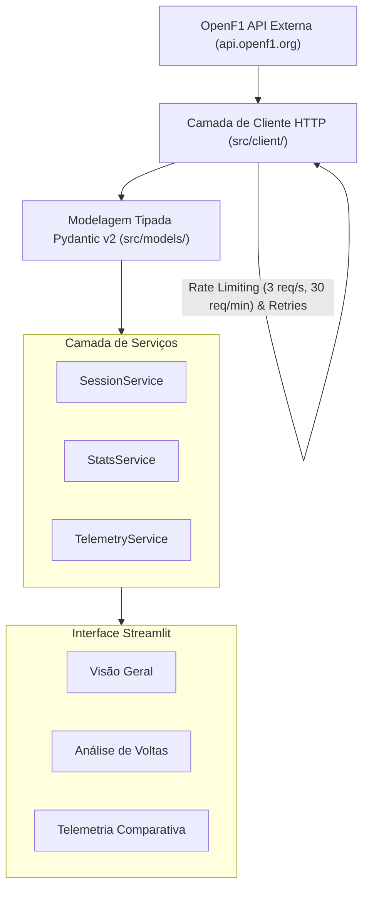

# Arquitetura da Solução

O projeto adota uma arquitetura em camadas desacoplada, separando claramente as responsabilidades de integração de rede, modelos de domínio, lógica de negócios e apresentação visual.

---

## Diagrama da Arquitetura

---

## Detalhamento das Camadas

### 1. Cliente HTTP (`src/client/`)
- **`RateLimiter`:** Gerencia em memória o volume de chamadas, garantindo que o teto do plano gratuito (*Community Tier*) não seja excedido.
- **`BaseClient`:** Configura timeout de 15 segundos, intercepta erros de rede e implementa retries com *exponential backoff* para respostas HTTP 429 e 5xx.
- **`OpenF1Client`:** Expõe métodos fortemente tipados para cada endpoint da API (`get_meetings`, `get_sessions`, `get_laps`, `get_car_data`, etc.).

### 2. Modelos Pydantic v2 (`src/models/`)
- Mapeiam os payloads JSON retornados pela OpenF1 em classes Python com tipagem estática.
- Schemas configurados com `extra="ignore"` para garantir tolerância a futuros campos introduzidos pela API sem quebrar a aplicação.
- Propriedades computadas como `hex_colour` em `Driver`, `total_laps` em `Stint` e `position_change` em `SessionResult`.

### 3. Camada de Serviços (`src/services/`)
- **`SessionService`:** Orquestra as consultas ao cliente HTTP e instancia as listas de modelos correspondentes.
- **`StatsService`:** Executa agregações matemáticas, cálculo de volta mais rápida, setores teóricos ideais, ritmo de corrida desconsiderando paradas no box e comparação direta entre companheiros de equipe.
- **`TelemetryService`:** Normaliza séries temporais de alta frequência, interpola dados de velocidade curva a curva em uma grade de distância comum e calcula deltas de velocidade e pressão no pedal.

### 4. Componentes e Visões Streamlit (`src/components/`, `src/views/`, `src/app.py`)
- **`sidebar.py`:** Seleção encadeada (Temporada ➔ Grande Prêmio ➔ Sessão ➔ Pilotos).
- **`charts.py`:** Geração de gráficos Plotly interativos com paletas de cores oficiais dos compostos de pneus e das escuderias.
- **`session_overview.py`:** Tabela de classificação com gaps, posições de largada e pontos.
- **`lap_analysis.py`:** Comparação gráfica de degradação e linha do tempo dos stints.
- **`telemetry_view.py`:** Comparativo curva a curva de aceleração, frenagem e velocidade máxima.

